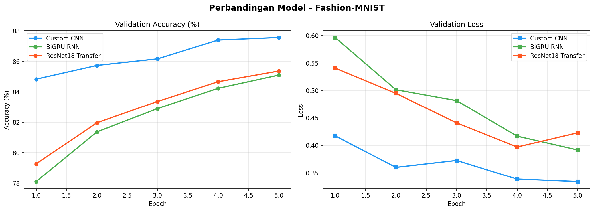
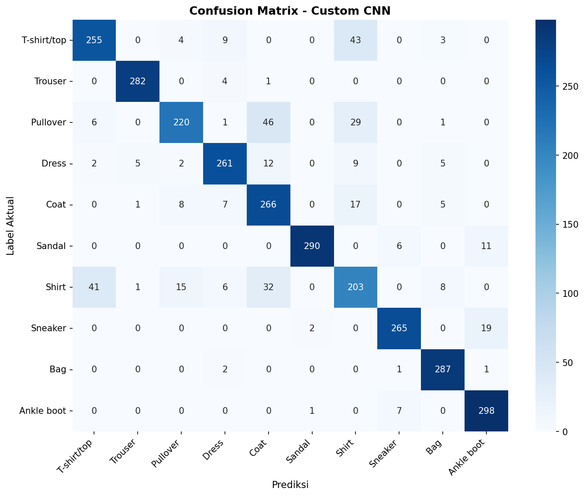
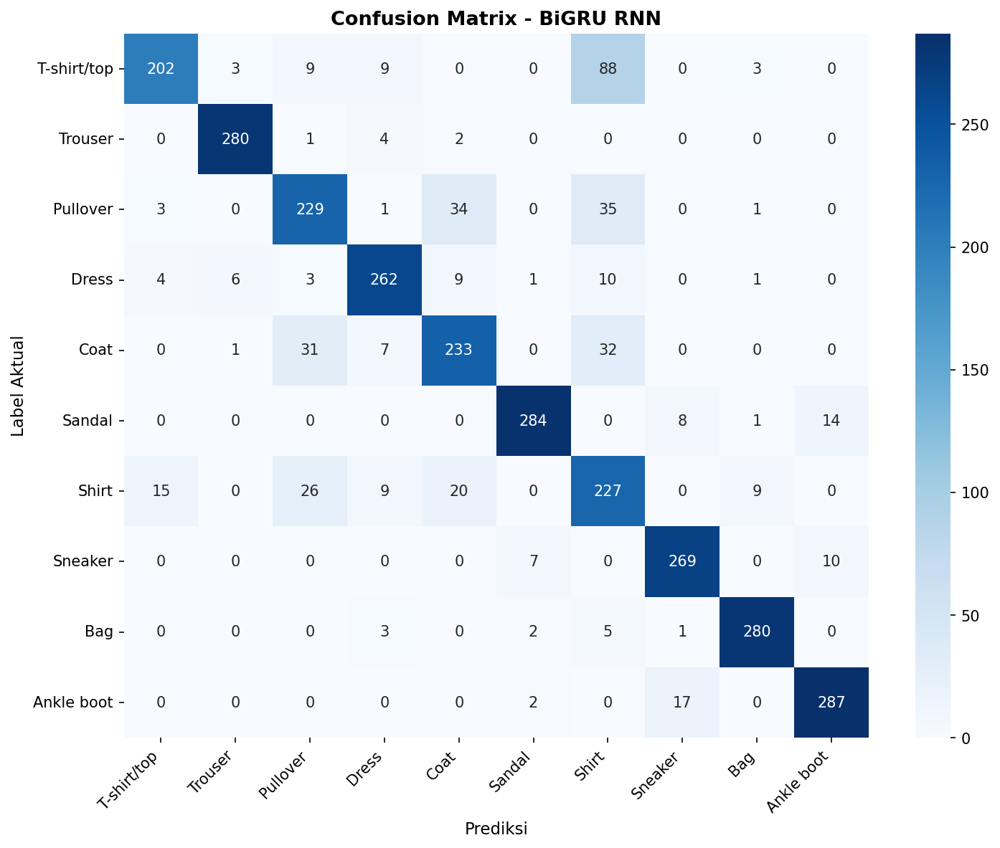
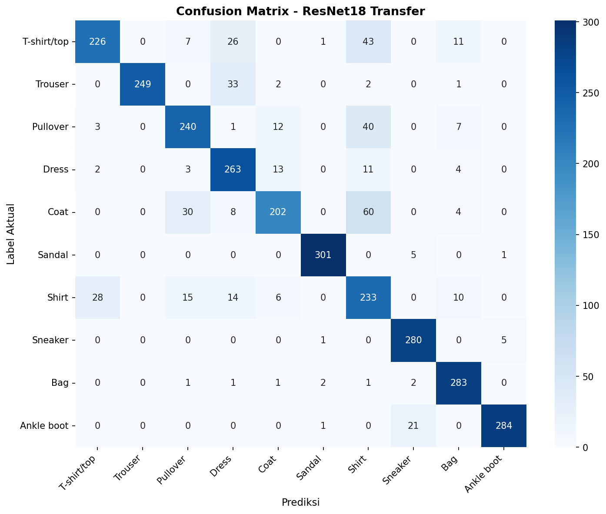

# Tugas Individu Deep Learning — Perbandingan 3 Arsitektur pada Fashion-MNIST

<div align="center">

| Informasi Mahasiswa | Keterangan |
|---|---|
| **Nama** | Nurul Marisa Clara Waldi |
| **NIM** | H071241015 |
| **Mata Kuliah** | Deep Learning |
| **Dataset** | Fashion-MNIST (10 Kelas) |
| **Hardware Akselerator** | Apple Silicon (MPS - Metal Performance Shaders) |

</div>

---

## 📋 Deskripsi Proyek

Proyek ini bertujuan untuk mengimplementasikan, melatih, serta membandingkan performa **tiga paradigma arsitektur deep learning yang berbeda** dalam menangani tugas klasifikasi citra pada dataset **Fashion-MNIST**:

1. **Custom Convolutional Neural Network (`CustomCNN`)**: Representasi arsitektur vision berbasis konvolusi 2D hierarkis.
2. **Recurrent Neural Network - Bidirectional GRU (`ImageBiGRU`)**: Representasi pengolahan citra sebagai data sekuensial (baris piksel sebagai urutan temporal).
3. **Transfer Learning ResNet-18 (`ResNet18_Transfer`)**: Representasi arsitektur deep residual learning dengan bobot pretrained dari ImageNet.

Semua model dilatih dan dievaluasi secara adil (*fair comparison*) dengan kondisi data, rasio split, optimizer, learning rate, dan jumlah epoch yang identik.

---

## 📦 Dataset Fashion-MNIST

Dataset Fashion-MNIST terdiri dari gambar produk pakaian dan aksesoris berformat grayscale berukuran **28×28 piksel** dengan **10 kategori kelas**:
- `0`: T-shirt/top
- `1`: Trouser
- `2`: Pullover
- `3`: Dress
- `4`: Coat
- `5`: Sandal
- `6`: Shirt
- `7`: Sneaker
- `8`: Bag
- `9`: Ankle boot

### Pengaturan Data (Sampling & Augmentasi)
- **Normalisasi**: `ToTensor()` diikuti `Normalize((0.5,), (0.5,))` untuk menskalakan nilai piksel ke rentang `[-1, 1]`.
- **Sampling**: Untuk efisiensi pelatihan dan konsistensi evaluasi, dataset disubset secara acak terdistribusi (*deterministic seed=42*):
  - **Training Set**: 15.000 sampel
  - **Testing/Validation Set**: 3.000 sampel
- **Batch Size**: 64

---

## 🏗️ Spesifikasi Arsitektur Model

### 1. Custom CNN (`CustomCNN`)
Arsitektur konvensional yang didesain khusus untuk mengekstraksi representasi fitur spasial 2D:
- **Blok Konvolusi 1**: `Conv2d(1 -> 32, kernel=3, padding=1)` $\rightarrow$ `BatchNorm2d(32)` $\rightarrow$ `ReLU` $\rightarrow$ `MaxPool2d(2, 2)` (Ukuran feature map: $14 \times 14$)
- **Blok Konvolusi 2**: `Conv2d(32 -> 64, kernel=3, padding=1)` $\rightarrow$ `BatchNorm2d(64)` $\rightarrow$ `ReLU` $\rightarrow$ `MaxPool2d(2, 2)` (Ukuran feature map: $7 \times 7$)
- **Klasifikasi**: `Flatten` $\rightarrow$ `Linear(64 * 7 * 7 = 3136 -> 128)` $\rightarrow$ `ReLU` $\rightarrow$ `Dropout(p=0.3)` $\rightarrow$ `Linear(128 -> 10)`

### 2. Bidirectional GRU (`ImageBiGRU`)
Pendekatan sekuensial yang memproses citra 2D sebagai deret waktu:
- Citra $28 \times 28$ direduksi dimensinya via `x.squeeze(1)` menjadi sekuens berpanjang $28$ step dengan masing-masing step membawa vektor $28$ fitur (tiap baris piksel).
- **Recurrent Layer**: `nn.GRU(input_size=28, hidden_size=128, num_layers=2, batch_first=True, bidirectional=True, dropout=0.2)`.
- Menggabungkan representasi tersembunyi arah forward dan backward ($128 \times 2 = 256$) dari time step terakhir.
- **Klasifikasi**: `Linear(256 -> 10)`.

### 3. Transfer Learning ResNet-18 (`ResNet18_Transfer`)
Pemanfaatan model deep residual pretrained ImageNet:
- Bobot awal diambil dari `ResNet18_Weights.DEFAULT`.
- **Modifikasi Conv Awal**: Layer pertama `model.conv1` diadaptasi untuk menerima citra 1-channel grayscale: `nn.Conv2d(1, 64, kernel_size=7, stride=2, padding=3, bias=False)`.
- **Modifikasi Output**: Layer `model.fc` diganti dengan `nn.Sequential(Dropout(0.3), Linear(512, 10))`.

---

## 📊 Hasil Evaluasi Aktual

Pengujian dilakukan menggunakan akselerator **Apple Silicon MPS** selama **5 epoch**, optimizer **Adam ($lr=0.001$)**, dan criterion **CrossEntropyLoss**.

Berikut adalah hasil aktual yang diperoleh dari file `outputs/metrics_summary.csv`:

| Model | Train Acc (%) | Val Acc (%) | Val Loss | Macro F1-Score | Waktu Training (s) |
|---|:---:|:---:|:---:|:---:|:---:|
| **Custom CNN** | **90.05%** | **87.57%** | **0.3340** | **0.8766** | **17.1 s** |
| **BiGRU RNN** | 86.49% | 85.10% | 0.3916 | 0.8543 | 33.4 s |
| **ResNet18 Transfer** | 88.06% | 85.37% | 0.4229 | 0.8560 | 47.3 s |

### Analisis & Pembahasan:
1. **Custom CNN** menghasilkan performa terbaik secara keseluruhan dengan **Akurasi Validasi 87.57%** dan **Macro F1-Score 0.8766**, serta memiliki waktu komputasi tercepat (**17.1 detik**). Hal ini menegaskan keunggulan konvolusi 2D dan inductive bias spasial dalam mengenali tekstur dan pola lokal pakaian.
2. **BiGRU RNN** mampu mencapai performa yang cukup kompetitif (**Akurasi Validasi 85.10%**). Hal ini menunjukkan bahwa struktur baris-demi-baris pada citra pakaian memiliki korelasi vertikal yang dapat dipelajari oleh mekanisme gating GRU, meskipun biaya komputasinya 2x lebih lambat dari CNN akibat ketergantungan temporal step-by-step.
3. **ResNet-18 Transfer Learning** mencapai **85.37% akurasi validasi**. Meskipun memiliki representasi fitur yang kaya dari ImageNet, model ini membutuhkan waktu komputasi lebih lama (**47.3 detik**) karena jumlah parameter yang jauh lebih besar (~11 juta parameter) dan ukuran filter $7 \times 7$ pada conv1 yang awalnya dirancang untuk citra $224 \times 224$.

---

## 📈 Visualisasi & Grafik Hasil

### 1. Kurva Perbandingan Metrik (Validation Accuracy & Loss per Epoch)
Grafik di bawah ini menunjukkan dinamika konvergensi dari ketiga model sepanjang 5 epoch pelatihan:



### 2. Confusion Matrix Masing-Masing Model
Heatmap berikut memperlihatkan distribusi prediksi benar dan salah untuk setiap kategori kelas:

#### a. Custom CNN


#### b. Bidirectional GRU (RNN)


#### c. Transfer Learning ResNet-18


---

## 🚀 Panduan Menjalankan Proyek

### 1. Kloning Repositori & Persiapan Environment
```bash
git clone <URL_REPOSITORY_ANDA>
cd tugas-5

# Buat virtual environment (opsional)
python3 -m venv .venv
source .venv/bin/activate

# Install dependensi
pip install -r requirements.txt
```

### 2. Menjalankan Skrip Training
```bash
python3 main.py
```
> *Catatan: Dataset Fashion-MNIST akan diverifikasi di folder `./data/FashionMNIST/raw/`. Script otomatis mendeteksi hardware (Apple Silicon MPS, CUDA GPU, atau CPU).*

### 3. Eksplorasi Menggunakan Jupyter Notebook
Bagi penguji yang ingin melihat visualisasi per langkah secara interaktif:
```bash
jupyter notebook notebook.ipynb
```

---

## 📁 Struktur Direktori Repositori

```text
tugas-5/
├── .gitignore                   # Mengabaikan data/, weights, venv, cache
├── requirements.txt             # Dependensi pustaka Python
├── README.md                    # Laporan dokumentasi akademik lengkap
├── main.py                      # Skrip end-to-end training & visualisasi
├── notebook.ipynb               # Jupyter notebook eksperimen interaktif
├── outputs/                     # Direktori hasil luaran eksperimen
│   ├── model_comparison.png     # Grafik kurva Accuracy & Loss
│   ├── cm_Custom_CNN.png        # Confusion Matrix Custom CNN
│   ├── cm_BiGRU_RNN.png         # Confusion Matrix BiGRU RNN
│   ├── cm_ResNet18_Transfer.png # Confusion Matrix ResNet-18
│   └── metrics_summary.csv      # Ringkasan angka metrik hasil evaluasi
└── data/                        # Dataset Fashion-MNIST (diabaikan git)
```
